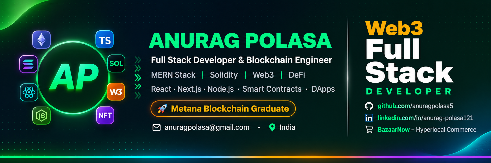

# 👋 Hi, I'm Anurag Polasa

### 🚀 Full Stack Developer | Blockchain Engineer | Web3 Enthusiast

Building scalable web applications, smart contracts, and decentralized products from India.

  

---

## 💫 About Me

- 🔭 Working on **BazaarNow** — *Your Neighbourhood Store Online*
- 🌱 Exploring **Solidity, Web3, AI tools, and modern full-stack development**
- 👯 Open to collaborating on **Full Stack, Blockchain, and Web3 projects**
- 💬 Ask me about **React, Next.js, Node.js, MERN Stack, Solidity, and smart contracts**
- ⛓️ Interested in **DeFi, NFTs, DAOs, and decentralized applications**
- 📫 Reach me at **[anuragpolasa@gmail.com](mailto:anuragpolasa@gmail.com)**
- 🌍 Based in **India**

## 🚀 Featured Project

### 🛒 BazaarNow — Your Neighbourhood Store Online

A hyperlocal grocery-commerce concept focused on connecting customers with nearby stores.

**Project areas**
- Multi-store marketplace and product discovery
- Customer and vendor experiences
- Shopping cart and checkout flows
- Order management and delivery tracking
- Payment and location-based integrations

**Technology areas:** React, Next.js, Node.js, Supabase, Firebase, and Google Maps API.

---

## 💻 Tech Stack

                                                    

---

## 📊 GitHub Stats

 
 

## 🏆 GitHub Trophies

  

## ✍️ Random Dev Quote

  

## 🔝 Top Contributed Repositories

  

## 🐍 Contribution Graph

  

### 🔝 Top Contributed Repo

  

---

### 💡 Building. Learning. Innovating.

**Let's connect and build something amazing together!**

